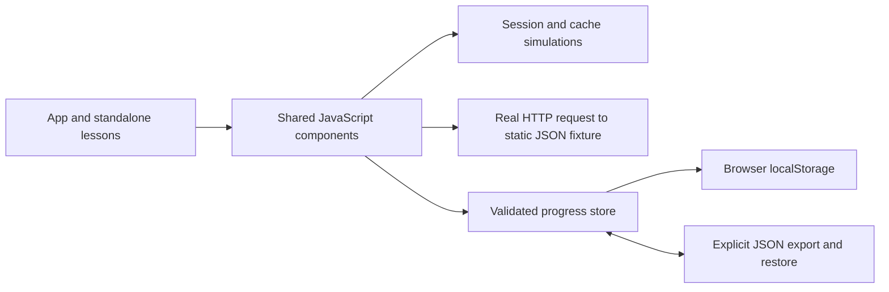

# Fieldnotes: the first learning product

Fieldnotes helps a learner choose one 30-minute session, investigate a mechanism, keep their own explanation, and return for spaced recall. It now contains 37 English lessons with graphics and working experiments, plus a broader 37-session map. All 37 scheduled sessions are now authored; practice, self-reported confidence and later retention remain separate.

## Behaviour and evidence

- The home page suggests the next unfinished available lesson and shows due reviews.
- Each lesson follows recall, exploration, experiment, and explanation. Attempts, hint use, confidence, lab observations, and notes save locally.
- Practice can be recorded after the experiment, two correct checks, and a personal explanation of at least 30 characters. The text length is a completion requirement, not an assessment of correctness.
- A changed review question becomes available after two days. An unassisted correct response schedules seven days; an incorrect or assisted response schedules one day. These intervals are simple defaults, not an adaptive learning model.
- The evidence page separates confidence from observed practice. “Bring to tutor” prepares context for the learner to copy; it sends nothing automatically.
- JSON export and explicit validated import support backups and device transfer. Newest saved entries win per lesson; notes are not combined field by field.

The learner must still explain the result and transfer it to a changed task. Passing these guided checks does not establish independent engineering competence. The agent's QA uses isolated synthetic profiles and does not populate learner progress.

## Implementation



The product is static HTML, CSS, and ES modules. It has no application backend, analytics, sign-in system, or automatic cloud sync. Hosted Site access is managed by Sites; it is separate from the simulated identity examples. Fonts are bundled under their included OFL licenses, so lessons do not request a font CDN.

`assets/curriculum.js` defines the route and ready/planned state. The `assets/lesson-data*.js` modules define recall prompts, checks, hints, and changed review questions. `assets/lesson.js` provides the reusable lesson engine. `assets/lab-models.js`, `assets/next-models.js`, `assets/foundation-models.js`, and the focused `assets/course-models/` modules contain inspectable mechanisms; the lab modules connect them to visual controls through `assets/lab-ui.js`. `assets/store.js` validates data and manages persistence and review dates.

Lesson one's fetch uses a real static response; it does not call a product API or database. Authentication, sessions, and caches use explicitly labelled browser-side models. They must not be reused as production security implementations.

The hardware lesson downloads a bounded standard-library Python script. It uses fresh processes, separate timing and allocation-tracing runs, equal-output checks, and two input sizes. The app accepts a learner-supplied JSON report and saves only short observation summaries, never the raw report. Validation is not an authenticity check or a grade. Peak RSS is optional and distinct from traced Python allocations.

The SQL lesson's browser table is an explicitly labelled relational model. The downloadable Python script executes the same fixture queries in a disposable SQLite database. API, TTL, and invalidation labs are local deterministic models, not live service integrations.

Sessions 11–15 add process/port, code-boundary, merge/lockfile, container-lifecycle, and grain models. Their downloadable exercises execute a real local child/HTTP service, shared Python rules, a new disposable Git repository, and SQLite queries/constraint failures. The Docker files build a real single-process counter; the command guide keeps loopback publishing and resource budgets explicit. Browser model completion never authenticates real command execution.

## Persistence and privacy

Progress is keyed by `fieldnotes.progress.v1` in the current origin's localStorage. A localhost copy and a hosted copy have separate data. Browser clearing, private browsing, or a different browser/device can remove or hide progress. Export backups regularly and use one active learning tab at a time; concurrent edits are not synchronized.

Imports accept the known schema/course and lesson IDs, whitelist fields, bound text and history sizes, and reject files over 1 MB. Notes render as escaped text. These controls protect the UI; imported completion records are personal bookkeeping, not signed attestations.

If existing saved data cannot be read, normal writes are blocked and the original browser value remains untouched. A valid restore is explicit. If a write fails, the current draft stays in memory and an on-page export button is available. Export before navigating away; memory-only drafts cannot survive page navigation. An unreadable original cannot be recovered by exporting the empty recovery state.

The build copies only `index.html`, `assets/`, `lessons/`, and `reference/` into `dist/`. It excludes the repository metadata, private `.local/` coaching notes, and diagnostic answers. Public exercise write-ups use `templates/exercise.md` and require the learner's own explanations and an honest account of assistance.

## Verification

Run the unit and static checks:

```sh
npm test
python -m unittest discover -s tests -p "*_test.py"
npm run build
python tests/build_smoke.py
```

The Python tests execute the downloadable resource, service, domain, Git, SQL, API-failure, event and recovery exercises, check equal results at two input sizes without machine-specific timing thresholds, and reproduce the SQL download layout. The Node suite also checks API shape/validation, pagination, join edge cases, fixed TTL, commit/rollback interleavings, and resource-report validation. It checks persistence failure handling, corrupt data protection, backup validation/merging, completion gates, review scheduling, curriculum breadth, session expiry/logout, and cache isolation/expiry/empty results.

For isolated end-to-end QA, start the built app and use Python Playwright with a Chromium browser:

```sh
python -m venv .local/qa-venv
.local/qa-venv/bin/pip install playwright==1.64.1
.local/qa-venv/bin/playwright install chromium
# In another terminal, run npm run dev.
.local/qa-venv/bin/python tests/browser_smoke.py
```

An installed Chrome can be used via `FIELDNOTES_CHROME=/path/to/google-chrome`. `FIELDNOTES_TEST_URL` overrides localhost. Screenshots and synthetic test backups stay under ignored `.local/qa/`; tests never use the learner's browser profile. The original browser QA script covers the first five labs and completion flows, reload persistence, filtering, invalid imports, backup transfer, escaped notes, due reviews, storage failure recovery, mobile layout, print styling, and page errors.

Sessions 6–10 were also checked through the browser UI on an isolated local origin: every lab path, completion gates, checks, saved explanations, and reload persistence. This included invalid resource reports, a locally generated four-case report, all four SQL presets, TTL expiry/reload, and three invalidation scenarios. All five pages were checked at a 390-pixel viewport; the populated resource table scrolls within its container. These are agent QA results, not learner practice. This batch did not repeat browser print rendering.

Sessions 11–15 were checked through CUA on a separate local origin: all model paths, concept checks, completion gates, saved explanations and reload persistence. Native controls and keyboard activation were exercised; all five pages fit a 390-pixel viewport, with internally scrolling SQL tables. Real Docker QA also passed. Print CSS was reviewed, but the current browser connection did not expose a print preview, so this batch has no new rendered-print verification. These are agent QA results, not learner progress.

Optional real Docker verification requires a running engine and may pull the pinned official Python base image:

```sh
python tests/docker_exercise.py
```

This builds from only the two exercise files, uses unique disposable names and OS-selected loopback ports, checks stop/start, replacement and volume retention, and removes only its own resources. It is separate from the no-Docker CI suite.

## Final course batch and tool verification

Sessions 16–37 use `assets/course-labs.js` for shared, accessible scenario controls and the existing lesson engine for recall, checks, explanation, confidence and spaced review. Their mechanisms and questions are split by web, data and decision responsibilities. Review/capstone models require an ungraded scratch attempt before feedback; the attempt is not saved, and the lesson explanation is the durable record. No free-form answer is automatically assessed.

The build creates deterministic ZIP downloads for the prepared dbt, Airflow and Compose projects from public source only. Generated environments, profiles, database files, logs and build caches are excluded. Run the tools in a new exercise folder, not in the public source tree.

Separate agent QA used Python 3.12 and isolated environments: dbt-duckdb 1.11.1, dbt-core 1.12.6 and DuckDB 1.5.5 passed clean seed/run/test; four planted input defects each failed their intended assertion, and the restored fixture passed. Airflow 3.3.2 with official matching constraints completed a first-attempt failure, retry and total-10 verification; a separate no-retry run failed with verify blocked. Neither run is a distributed-executor test.

The optional Compose check is `python tests/stack_exercise.py`. It verifies real Nginx proxying, service-name connectivity, an upstream gateway failure, recovery and volume retention. This machine's default Docker pools were exhausted, so QA used the script's explicit unused private /28 option after checking existing networks and host routes. It did not prune or alter unrelated networks. Actual upstream shutdown yielded HTTP 504 here, while the browser's controlled refusal case is 502. The guide distinguishes those observations.

A real two-origin CORS probe confirmed that both simple GETs reached the API while only the permitted response was readable to browser JavaScript. It sends no credentials or external requests. WeasyPrint produced 24 static HTML/CSS previews for the new lessons and references; this checks static content and diagrams, not browser print of JavaScript-rendered lab state.

## Extend a lesson

Keep one objective per session and preserve the domain allocation. Write a standalone numbered HTML file under `lessons/` using the existing sections and shared assets. Add its prompts/checks to `lesson-data.js`, a focused experiment where necessary, and then set its curriculum file and ready state. Link the relevant primary sources and reference sheet. Keep answer choices equal in word count, label simulations, and record hint use. Run the checks before publishing; do not prefill a learner's explanation or completion.

The private Site and the public GitHub repository have distinct source histories. Sites publication uses an isolated checkout containing public source only, the tracked hosting manifest, and a build produced from that source. Credentials are provided to the Sites helper through hidden stdin, never stored in the repository.


Final browser QA ran all 22 new lesson flows on an isolated localhost origin: every prepared scenario, both concept checks, explanation gates, practice save and reload persistence. All 22 populated model layouts fit 390px; long scenario names also have a wrapped description and result heading. The complete map has 37 ready and zero planned entries, ending December 23. No app runtime errors were observed. Synthetic QA records are not learner evidence and were not entered on the hosted origin.

Build output versions the stylesheet URL by its content hash so a new page does not keep an older cached style. Public-boundary checks cover all 37 HTML lessons, linked assets, and the three deterministic source-only download bundles. The normal suite has 40 Node tests and 17 standard-library Python tests; dbt, Airflow, real CORS and Compose checks were run separately with their prepared environments.
